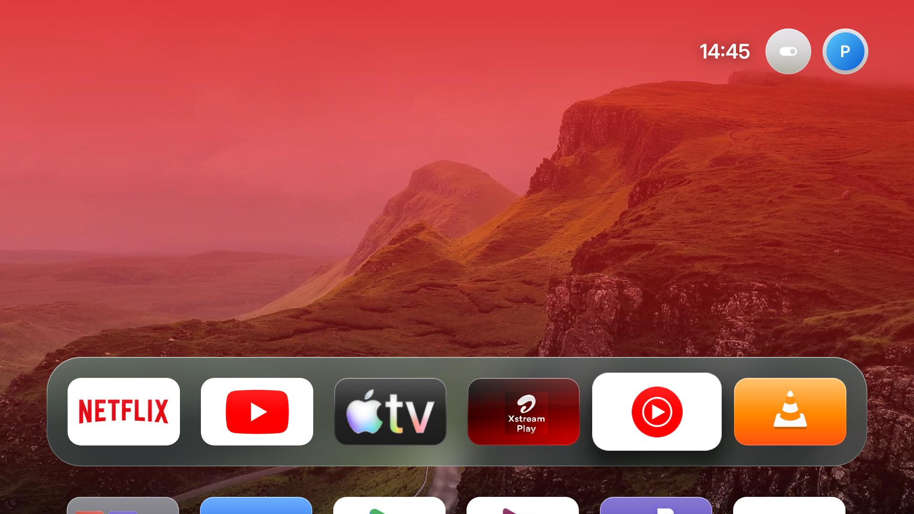
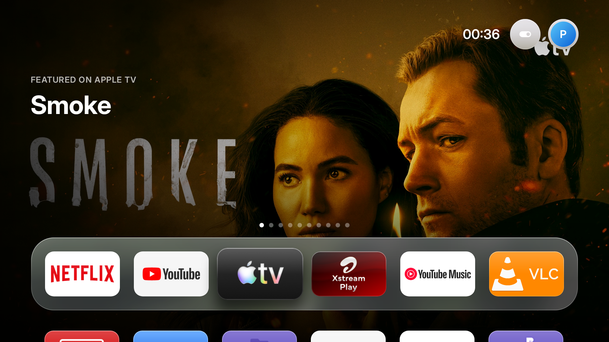
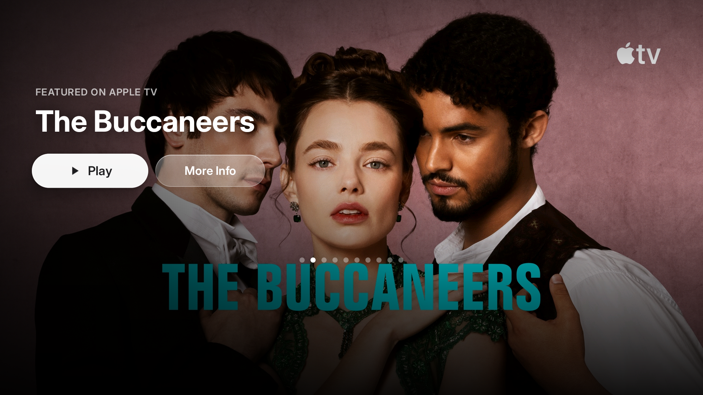
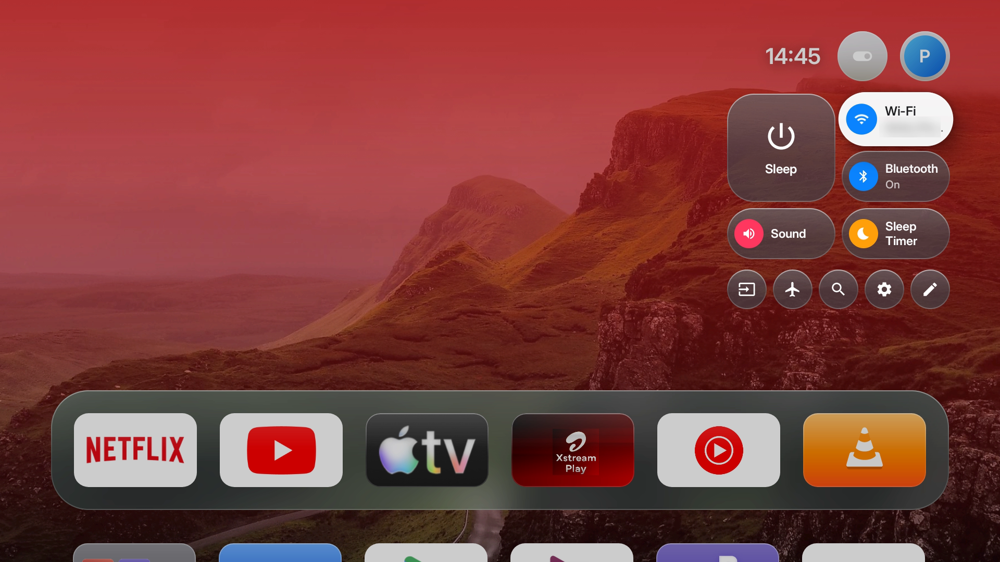
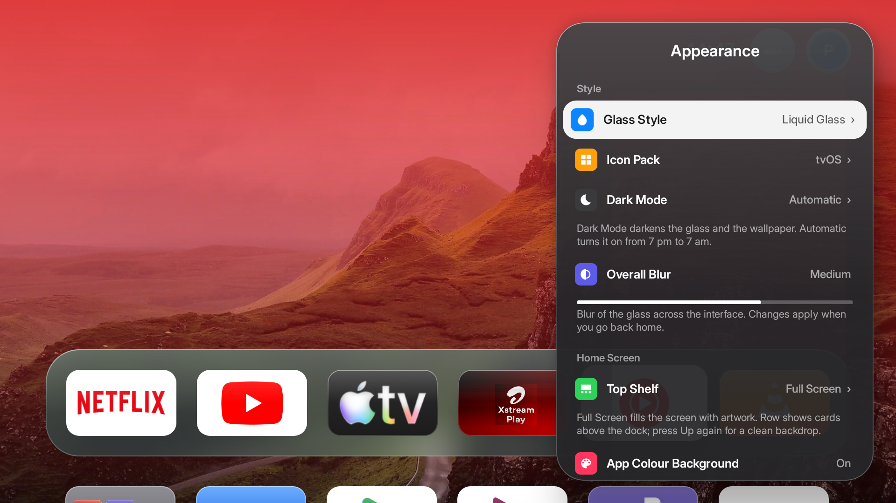
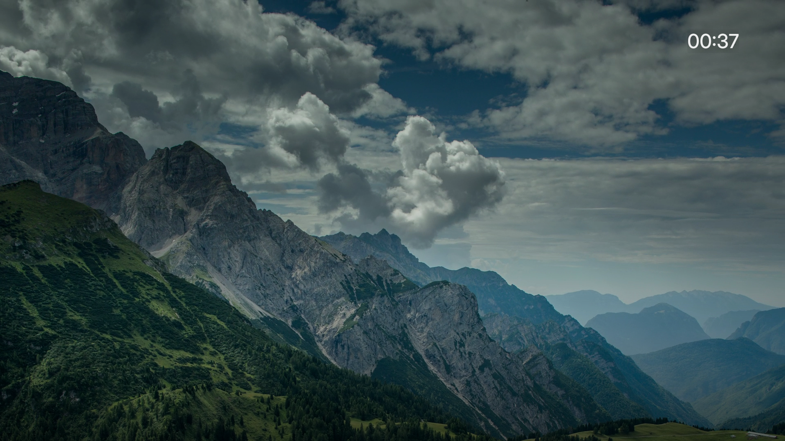
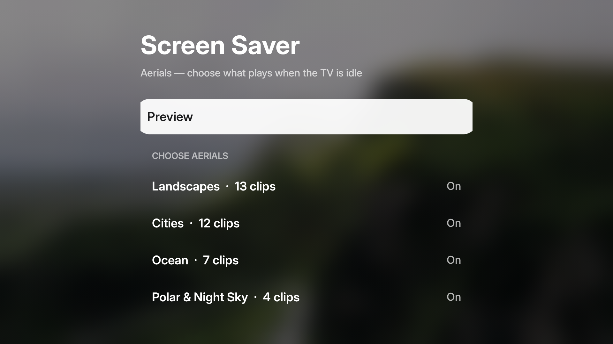

# GlassHome TV

A lightweight, tvOS-inspired home screen for Android TV / Google TV: a glass dock, a
full-screen Top Shelf, a compact Control Center, Aerial screensavers and spring-based focus motion.
It replaces the stock launcher (~126 MB of RAM) with a ~1.6 MB app, which makes budget TVs feel
much faster.

Built and tested on an **iFFALCON / TCL Google TV (Android 12, 1080p UI on a 4K panel)**. It should
run on any Android TV with Android 9 or newer; the remote-button mappings and `debloat.sh` are
TCL-specific.

> Not affiliated with or endorsed by Apple. "Apple TV" and "tvOS" are trademarks of Apple Inc.
> No Apple code, artwork or assets are included.



## Features

- **Home screen** – glass dock (up to 6 favourites, Add/Remove from Dock), app grid below that
  appears when you press Down, wallpapers, folders, hide / move apps (hold OK on an icon).
- **Top Shelf** – focus an app in the dock and its *Continue Watching* (e.g. Netflix) or featured
  content fills the screen with title, description and progress. Press Up for **Resume / Play** and
  **More Info**; Left/Right to page. Data comes from the TV's own database (TvContract).
  Optional **Row** style: a card row above the dock, and Up again for a clean full-screen backdrop.
- **Control Center** – gear button on the remote (works inside apps too): Sleep, Wi-Fi, Bluetooth,
  Sound, Sleep Timer, Inputs, Screen Saver, Search, Settings, Now Playing. Customisable (✏️ button).
- **Aerials screensaver** – slow drone footage with place names (OK shows where; ◀ ▶ skip); choose
  categories in Screen Saver settings.
- **Profiles** – "Who's Watching?" with a separate dock and wallpaper per person.
- **App Switcher** – double-press Home: recent apps as big cards with a glow in the app's colour,
  a live RAM meter, and Up to remove an app from Recents.
- **tvOS icon pack** – each app's own logo, scaled to tvOS proportions on its brand colour
  (or switch back to the apps' original TV banners).
- **Appearance** – Liquid Glass or Frosted Glass, Dark Mode (On / Automatic after 7 pm), blur level,
  Top Shelf style, and an app-colour background that tints the screen for the selected dock app.
- **Settings panels** – Customise, Appearance and Screen Saver open as a glass panel over the home
  screen, in the tvOS settings style.
- **Remote shortcuts** – Netflix / Prime Video / YouTube buttons on TCL remotes.
- App open/close zoom, spring-physics focus motion, focus click sound, night dimming after 9 pm.

| Top Shelf | Top Shelf (press Up) |
|---|---|
|  |  |

| Control Center | Appearance |
|---|---|
|  |  |

| Aerials | Screen Saver settings |
|---|---|
|  |  |

## Install

You need a computer on the same Wi-Fi as the TV, with:

- `adb` (Android platform tools), a JDK 11+, and the Android SDK packages
  `platforms;android-34` and `build-tools;35.0.0`.
  On macOS: `brew install --cask android-platform-tools android-commandlinetools`, then
  `sdkmanager "platforms;android-34" "build-tools;35.0.0"`.
  Elsewhere, set `ANDROID_HOME` to your SDK.

On the TV: **Settings → Device Preferences → About → press Build 7 times**, then turn on
**Developer options → USB debugging** (and network debugging if offered). Note the TV's IP address
(Settings → Network).

```sh
./build.sh
TV=192.168.1.20 ./install.sh        # accept the "Allow debugging" prompt on the TV the first time
TV=192.168.1.20 ./make-default.sh   # make it the home screen
```

After any code change: `./build.sh && TV=… ./install.sh`.

Optional, TCL / iFFALCON only: review and run `TV=… ./debloat.sh` to remove preinstalled extras.

**To undo everything:** `TV=… ./restore.sh` (brings back the Google TV launcher, system animations and
any removed apps). Nothing is ever deleted from the system partition; a factory reset also restores
everything.

### What `install.sh` changes on the TV

| Setting | Why |
|---|---|
| Accessibility service *Home Control Center* | Catches the gear / app buttons and double-press Home |
| Notification listener | Now Playing in Control Center |
| Usage access | Recent apps in the App Switcher |
| `READ_TV_LISTINGS` | Top Shelf content |
| Location permission | Showing the Wi-Fi network name |
| `WRITE_SECURE_SETTINGS` | Re-enables the button service if Android switches it off |
| `transition_animation_scale = 0` | The launcher draws its own app open/close animation |
| Screensaver → Aerials | |

## Customising

- **Profile names:** `Profiles.NAMES` in `app/src/.../Profiles.java`.
- **Dock defaults / first-run order:** `DEFAULT_ORDER` in `MainActivity.java`.
- **Appearance / Control Center:** from Control Center → ✏️ Customise.
- **Remote app buttons:** `APP_KEYS` in `KeyService.java` (key codes for other remotes can be found
  with `adb logcat | grep handleKeyBeforeQueueing`).
- **Aerial clips:** `CLIPS` in `AerialView.java`.

## Known limitations

- The open/close animation imitates tvOS; third-party launchers can't animate another app's real
  window (Android reserves that for system launchers).
- On low-end TVs animations run at ~48 fps; true glass blur behind other apps isn't available.
- "Remove from Recents" only stops apps Android considers idle; force-stopping busy apps needs
  system or adb privileges, which the launcher deliberately doesn't take.
- Top Shelf only shows apps that publish to Android's TV database (Netflix, YouTube, Apple TV app,
  Prime Video's picks, Airtel Xstream, …). No app currently publishes preview videos.
- The remote's gear button only reaches the launcher through the accessibility service; some TV
  firmwares (TCL) need `APP_AUTO_START`, which `install.sh` grants.

## Credits

- **Inter** typeface by Rasmus Andersson – SIL Open Font License 1.1 (`app/assets/Inter-OFL.txt`).
- Wallpapers from Unsplash (Unsplash License): Alexey Topolyanskiy
  ([fjord](https://unsplash.com/photos/-oWyJoSqBRM)), Andrew Ridley
  ([highlands](https://unsplash.com/photos/Kt5hRENuotI)), Wolfgang Lutz
  ([himalaya](https://unsplash.com/photos/yOujaSETXlo)), Ales Krivec
  ([lake](https://unsplash.com/photos/HkTMcmlMOUQ)).
- Aerial videos are streamed from [Mixkit](https://mixkit.co) (Mixkit free licence); none are bundled.
- Icons adapted from Material Design Icons (Apache 2.0).

## License

MIT – see [LICENSE](LICENSE).
